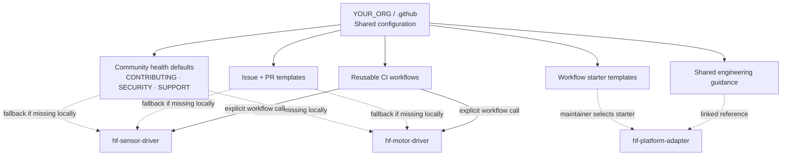
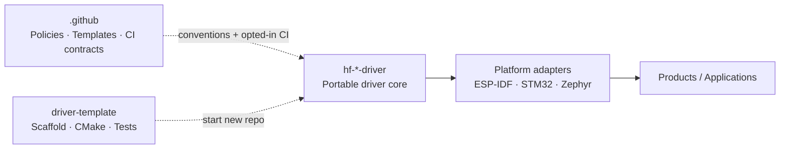
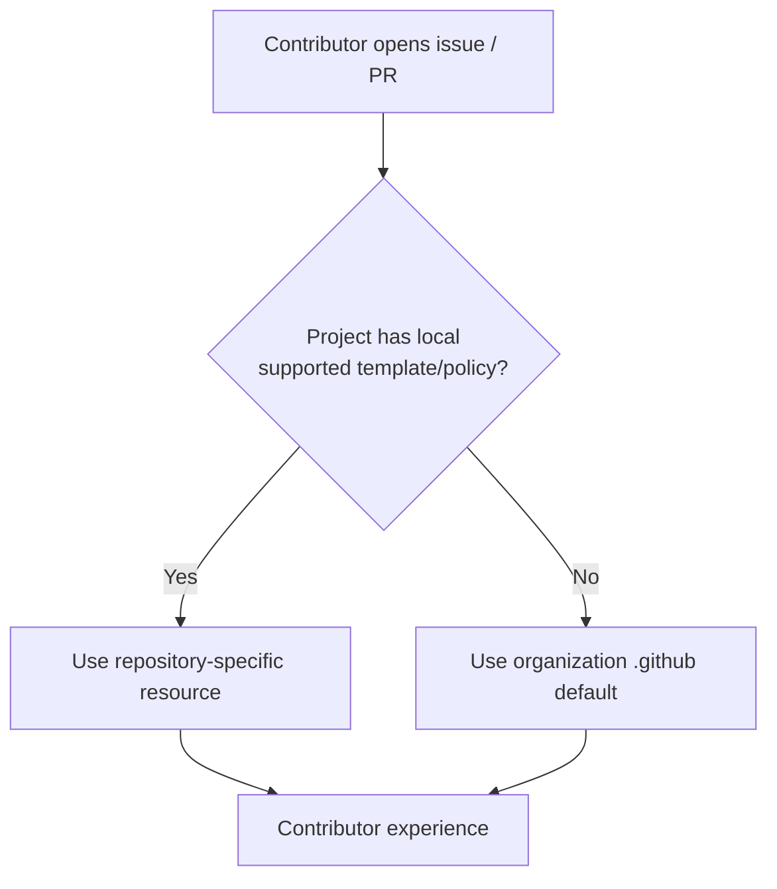
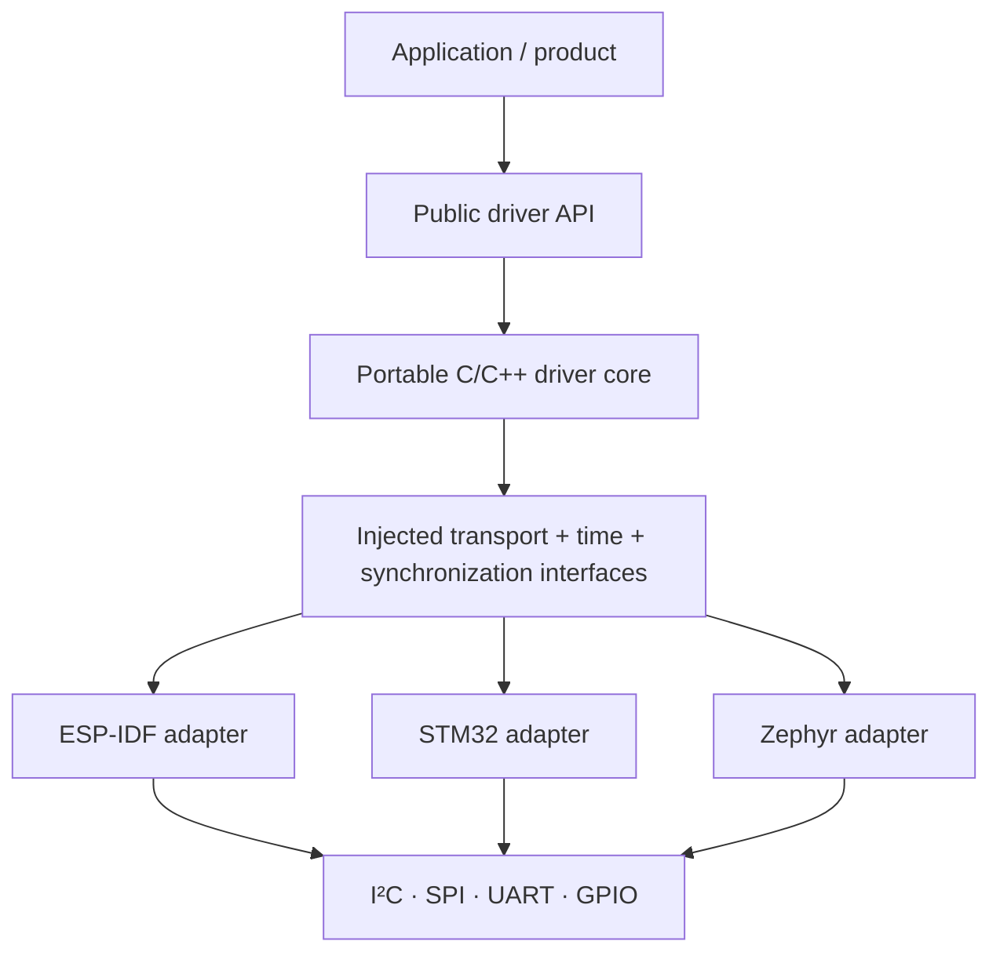
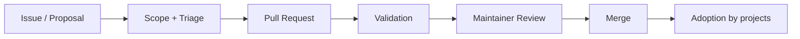

<div align="center">

# Organization Engineering Infrastructure

**Shared repository standards · Contribution workflows · Automation · Governance**

The central configuration and documentation repository for **`YOUR_ORG`**.

[](https://github.com/conmed-advanced-surgical)


*One coherent contributor experience across independently versioned embedded software projects.*

[Overview](#overview) · [Architecture](#architecture) · [Repository layout](#repository-layout) · [Adoption](#how-repositories-use-these-resources) · [Maintenance](#maintainer-guide)

</div>

---

> [!IMPORTANT]
> This is the **root README of the `.github` repository**, intended for maintainers and contributors. It is **not** the organization homepage. The public organization profile lives in [`profile/README.md`](profile/README.md) if that file is created.

## Overview

This repository establishes the conventions that make the organization's projects easier to discover, contribute to, review, secure, and maintain. It provides **shared defaults** without forcing every repository to have identical requirements.

The organization develops reusable, platform-agnostic **C/C++ embedded drivers** and platform integration layers for environments including **ESP-IDF, STM32, and Zephyr**. Each driver remains independently consumable, testable, and releasable; this repository governs the *development experience*, not runtime dependencies.

### Design objectives

| Principle | What it means |
|:--|:--|
| **Consistency** | Issues, PRs, security reporting, and basic contribution guidance follow recognizable conventions. |
| **Portability** | Shared engineering guidance supports portable driver cores and thin platform adapters. |
| **Autonomy** | Individual repositories can override defaults when their hardware, platform, or release requirements differ. |
| **Reproducibility** | Automation is explicit, testable, versioned, and pin-able by consumers. |
| **Security by design** | Vulnerability reports use responsible channels; workflow permissions stay minimal. |
| **Low maintenance** | Define common policies once and keep project-specific implementation close to each project. |

## Architecture

### 1 · Organization-wide configuration flow



**Legend:** Dotted lines indicate guidance, fallback, or a manual selection; solid lines indicate explicit relationships. GitHub does **not** automatically run workflows or import documentation from this repository into other repositories.

### 2 · Responsibility boundaries



**Boundary rule:** This `.github` repository is not a common driver library, build dependency, SDK, or monorepo. Runtime code and platform adapters belong in dedicated implementation repositories. Scaffold files belong in a project-template repository.

## Repository layout

The following is the **target layout**. Add the files incrementally; links to files below are only valid once those files exist.

```text
.github/                            # Organization repository (repository name)
├── README.md                       # This maintainer-facing guide
├── profile/
│   └── README.md                   # Organization profile (distinct purpose)
├── CONTRIBUTING.md                 # Shared contribution guidance
├── CODE_OF_CONDUCT.md              # Community expectations
├── SECURITY.md                     # Responsible disclosure policy
├── SUPPORT.md                      # Support and help channels
├── GOVERNANCE.md                   # Optional project governance reference
├── .github/
│   ├── ISSUE_TEMPLATE/
│   │   ├── bug_report.yml          # Structured defect report
│   │   ├── feature_request.yml     # Enhancement proposal
│   │   ├── hardware_support.yml    # MCU / bus / hardware support request
│   │   └── config.yml              # Issue chooser settings
│   ├── PULL_REQUEST_TEMPLATE.md    # Shared pull request checklist
│   └── workflows/
│       ├── driver-ci.yml           # Explicitly called reusable workflow
│       └── validate-repo.yml       # Checks for this repository
├── workflow-templates/
│   ├── driver-ci.yml               # Selectable new-workflow starter
│   └── driver-ci.properties.json   # Starter metadata
└── docs/
    ├── driver-architecture.md     # Interfaces and portability guidance
    ├── coding-standards.md        # C/C++ and formatting conventions
    ├── testing-strategy.md        # Host tests and hardware validation
    ├── versioning-policy.md       # Release and compatibility policy
    └── platform-support.md        # Supported adapters and toolchains
```

> [!NOTE]
> The outer `.github/` above is the **repository name**; the inner `.github/` is a **directory inside it**. `workflow-templates/` is at the repository root, whereas runnable and reusable workflows live in `.github/workflows/`.

## What GitHub applies automatically

| Resource | Shared automatically? | Behavior |
|:--|:--:|:--|
| `profile/README.md` | Yes | Displays on the organization's public GitHub profile. |
| `CONTRIBUTING.md` | Fallback | Used when a project has no corresponding local file. |
| `CODE_OF_CONDUCT.md` | Fallback | Common community expectations unless locally overridden. |
| `SECURITY.md` | Fallback | Common vulnerability reporting guidance unless locally overridden. |
| `SUPPORT.md` | Fallback | Common support instructions unless locally overridden. |
| `.github/ISSUE_TEMPLATE/` | Fallback | Project-local issue-template configuration can supersede the default set. |
| `.github/PULL_REQUEST_TEMPLATE.md` | Fallback | Prepopulates PR descriptions when not overridden. |
| `workflow-templates/` | **No** | Maintainers choose a template when creating a workflow. |
| `.github/workflows/` | **No** | Workflows are **not pushed** into other projects; callers must reference reusable workflows explicitly. |
| `docs/` and `GOVERNANCE.md` | **No** | Reference material unless explicitly linked or enforced through other mechanisms. |

For standard public organizations, the `.github` repository must be **public** for default community health files to work. GitHub looks for a corresponding file in the destination repository first, and only then falls back to the organization's defaults. These defaults are not copied into repository clones.

**Exceptions worth remembering:** Each project must include its **own license**, version metadata, and any hardware-specific safety/testing policies. A license in `.github` is *not* inherited by other repositories. Organization rulesets, branch protection, and access permissions must be configured through GitHub's appropriate administration controls; a Markdown policy alone does not enforce them.

## How repositories use these resources

### Path A · Community defaults (automatic fallback)



A driver may supply specialized issue forms for SPI or CAN faults, while another may use the shared defaults. Avoid duplicating a common file in every repository unless customization is required.

### Path B · Reusable CI (explicit opt-in)

To share actual CI execution logic, define a reusable workflow in this repository and invoke it from a consumer repo. A starter template is different: it merely creates a starting workflow file and does **not** automatically stay synchronized.

**Consumer repository** — `.github/workflows/ci.yml`:

```yaml
name: CI
on:
  push:
  pull_request:

permissions:
  contents: read

jobs:
  portable-tests:
    uses: YOUR_ORG/.github/.github/workflows/driver-ci.yml@v1
```

**Organization repository** — `.github/workflows/driver-ci.yml` (minimal illustration):

```yaml
name: Shared Driver CI
on:
  workflow_call:

permissions:
  contents: read

jobs:
  host-build:
    runs-on: ubuntu-latest
    steps:
      - uses: actions/checkout@v4
      - name: Configure
        run: cmake -S . -B build -DCMAKE_BUILD_TYPE=Release
      - name: Build
        run: cmake --build build --parallel
      - name: Test
        run: ctest --test-dir build --output-on-failure
```

This assumes each consumer repository provides a host-buildable CMake project and tests. Platform-specific builds (ESP-IDF, STM32 cross-compilation, Zephyr/west) should be opt-in jobs or separate reusable workflows, not mandatory for every driver.

> [!TIP]
> Use a protected release tag such as `v1` for a stable shared CI contract, or pin to a full commit SHA for stronger supply-chain reproducibility. Validate new workflow versions before updating consumers. Replace `YOUR_ORG` with the actual organization slug.

## Engineering standards

Central docs establish expectations; each driver keeps its own implementation and API details.

| Concern | Organization guidance | Repository-owned evidence |
|:--|:--|:--|
| Architecture | Portability contract and HAL boundary | Driver API, adapters, diagrams |
| Style | Formatter, language versions, naming | Local configuration and passing checks |
| Quality | Unit-testing and static-analysis policy | Tests, mocks, hardware validation |
| Compatibility | Versioning and support policy | Changelog, tags, compatibility matrix |
| Security | Disclosure process and minimum CI permissions | Dependencies, advisories, firmware risk assessment |
| Releases | Review and signing expectations | Build artifacts, checksums, signed releases as applicable |

### Portable driver boundary



**Core rule:** Portable drivers should not directly depend on vendor HAL headers or OS-specific APIs. Keep adapters thin and avoid introducing circular dependencies between drivers and platform infrastructure.

## Contribution lifecycle



Changes to shared files may affect many repositories. In particular, a modification to an inherited template can change the new-issue experience immediately, whereas a new reusable-workflow version only affects callers that reference it.

For contribution details, maintainers should add [`CONTRIBUTING.md`](CONTRIBUTING.md). Security-sensitive reports should follow [`SECURITY.md`](SECURITY.md) once published rather than being disclosed in public issues.

## Maintainer guide

### Adding or changing a shared policy

1. Identify whether the content is an **inherited community-health default**, **optional template**, **executable workflow**, or **reference document**.
2. Confirm the file path and naming conventions supported by GitHub.
3. Preserve sensible repository-level overrides and avoid project-specific wording in organization defaults.
4. Open a PR describing who is affected and how the change is validated.
5. For workflows, test with at least one representative consumer and publish or update a versioned ref.
6. Communicate behavioral changes to maintainers of affected repositories.

### Change impact guide

| Change | Impact | Recommended validation |
|:--|:--|:--|
| Common contribution policy | New visitors see updated guidance | Verify rendered links and scope |
| Shared issue form | New issue experience may change | Validate YAML schema and issue chooser |
| PR template | Changes new PR descriptions | Test template in a repo without a local override |
| Workflow starter | Available for new workflow creation | Validate metadata and resulting YAML |
| Reusable workflow | Explicit callers of changed ref affected | Test with a consumer, version carefully |
| Engineering guideline | No automatic execution | Review applicability and communicate |

### Maintenance checklist

- [ ] Keep organization URL, links, and support contacts current.
- [ ] Review policy defaults when onboarding new repositories.
- [ ] Validate issue forms and PR templates before merging.
- [ ] Use least-privilege workflow permissions and review external actions.
- [ ] Test reusable workflow changes against representative drivers.
- [ ] Preserve project-local exceptions when requirements legitimately differ.
- [ ] Keep repository-specific licenses and hardware safety documentation in their own repositories.

## Scope and non-goals

This repository **does** define common collaboration patterns, provide optional automation building blocks, and document engineering conventions.

It **does not** host driver source code, own platform SDKs, automatically enforce arbitrary policy documents, or automatically inject CI into all repositories. Separate enforcement, templates, and implementation repositories are deliberate architectural choices.

## References

- [GitHub — Default community health files](https://docs.github.com/en/communities/setting-up-your-project-for-healthy-contributions/creating-a-default-community-health-file)
- [GitHub — Reusing workflows](https://docs.github.com/en/actions/how-tos/sharing-automations/reuse-workflows)
- [GitHub — Creating workflow templates](https://docs.github.com/en/actions/how-tos/sharing-automations/creating-workflow-templates-for-your-organization)
- [GitHub — Issue and pull request templates](https://docs.github.com/en/communities/using-templates-to-encourage-useful-issues-and-pull-requests/about-issue-and-pull-request-templates)

---

<div align="center">

**Consistent engineering practices. Independent repositories. Portable software.**

*Maintained by the `YOUR_ORG` organization.*

</div>
